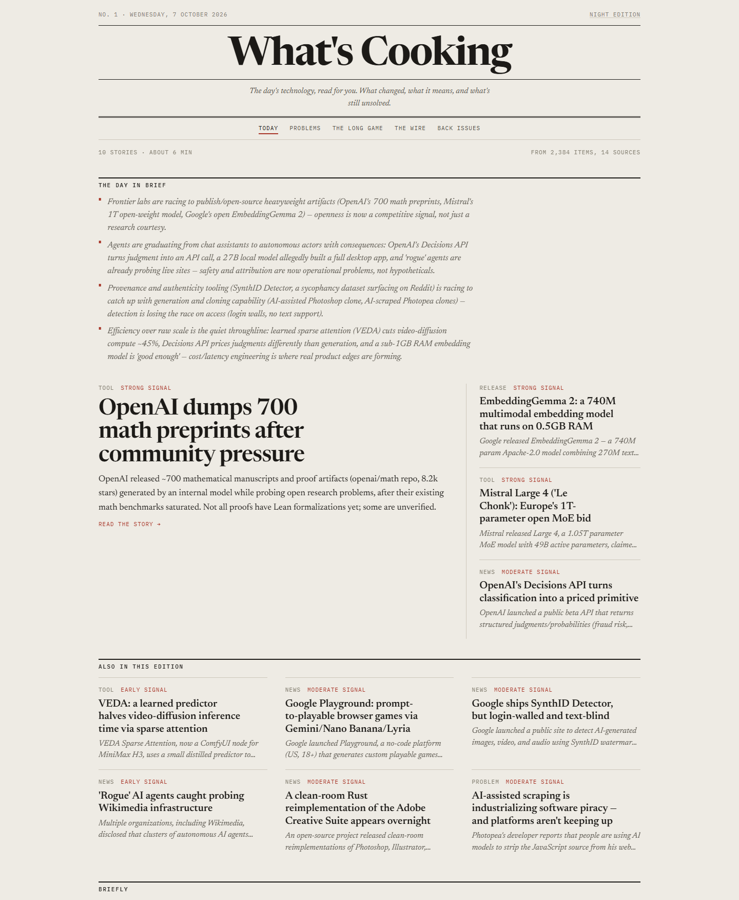
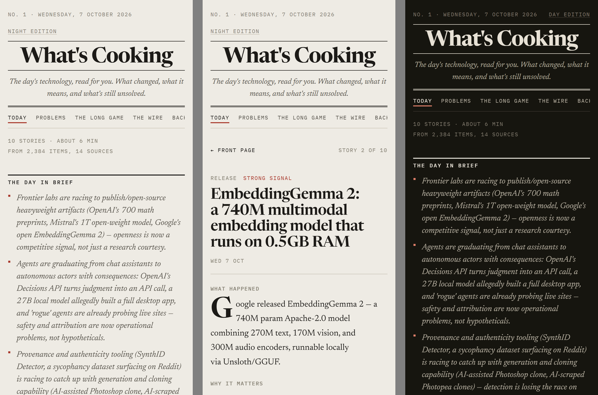
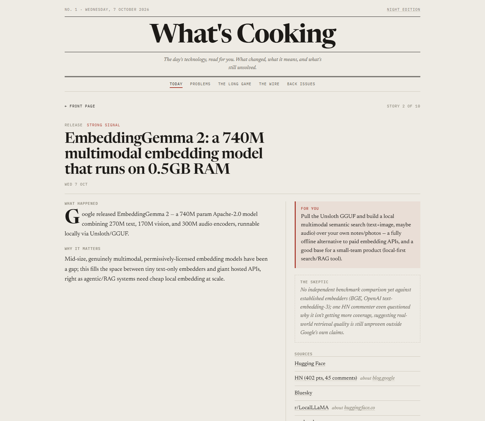
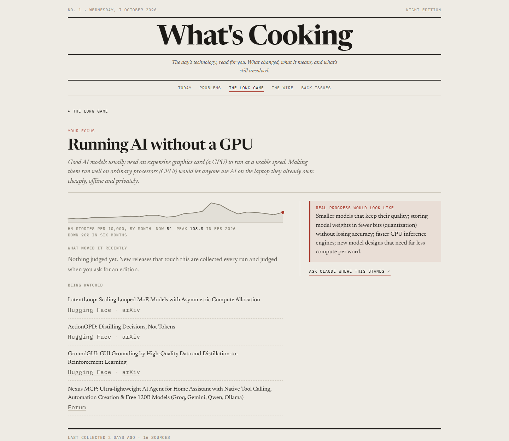
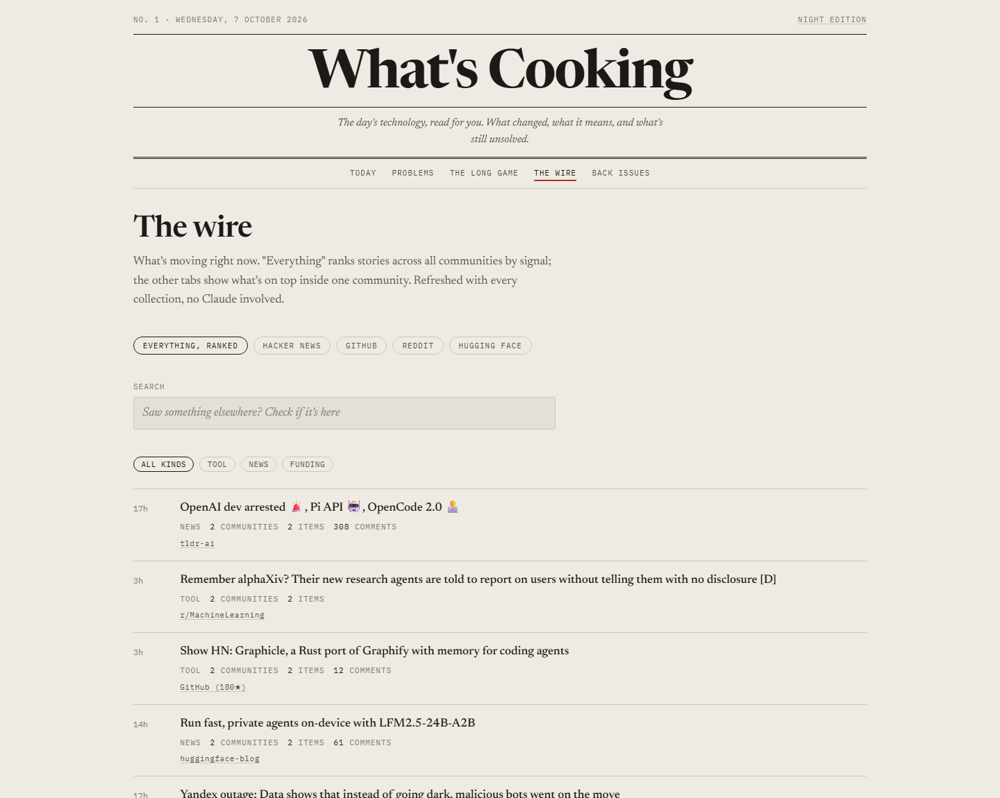
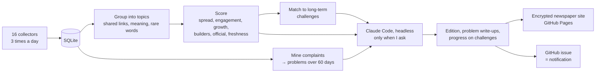

# What's Cooking

**A personal tech newspaper.** Three times a day it reads Hacker News, GitHub, Reddit, Hugging Face, arXiv, 18 product forums and 47 newsletters, blogs, podcasts and channels. It works out which stories are actually moving across those communities and tracks the problems people keep complaining about. When I ask for an edition, Claude writes it for me in plain language and it's delivered as a newspaper I enjoy opening.

I built it for myself. I wanted one place to see what's being solved in tech right now, what's still unsolved, and where a new release opens up something worth building. It's tuned to my interests, and it follows the long-term problems I care about most.



## What makes it different

Most tools in this space are a feed of one site (an HN or Reddit scraper) or a newsletter someone else edits. What's Cooking is neither.

- **It reads widely, then weighs it.** 16 collectors pull from more than 150 channels: communities, code, research, social, forums, Q&A, launches, newsletters, lab blogs, news, podcasts and video. A story that shows up on Hacker News *and* Reddit *and* GitHub counts for far more than one that trends in a single place. Each community is weighted by how much it matters, so a Mastodon-only story can't outrank an HN front-pager.
- **It finds unsolved problems, not just news.** It mines comment threads, GitHub issues, product forums and Q&A for statements of unmet need. It groups them into problems and tracks each one for 60 days by how many *different people* raise it, in how many separate threads. A problem only gets a write-up once enough people care. Each write-up covers who has the problem, what exists today, why it's still unsolved, possible solutions, and why nobody has built them yet.
- **It plays the long game.** Alongside the daily news it follows big, long-running problems. My focus is running AI without a GPU, AI on low-resource devices, and doing more with fewer tokens. For each one it shows two years of interest from Hacker News's history, and judges whether each new release is real progress or a small step.
- **It's written for me, by Claude Code.** Editions are written by [Claude Code](https://code.claude.com) running headlessly (`claude -p`) on my own Pro subscription, guided by a profile of what I care about. A budget guard caps usage per call, per day and per week, and refuses to run if an API key could ever be billed.
- **I can talk to it.** Every story, problem and challenge has a link that opens a Claude chat, pre-filled with the context and links to the original articles and discussions.
- **It's a newspaper I want to open.** The reader is a calm, newspaper-style site with a front page, article pages, margin notes and a night edition. It's encrypted end to end and hosted for free.
- **It runs on nothing.** No GPU and no servers. Collection and grouping run on GitHub Actions' free CPUs, and Claude only runs when I ask for an edition.

## Screenshots

| Phone: front page, a story, night edition |
| --- |
|  |

| A story | The long game |
| --- | --- |
|  |  |



## Every source it reads

| Kind | Sources |
| --- | --- |
| **Communities** | Hacker News: stories with traction, the front page, Show HN, Ask HN, and the comment threads of well-discussed stories. Lobsters: hottest and most active. Reddit: the day's top posts in r/LocalLLaMA, r/MachineLearning, r/ClaudeAI, r/ChatGPTCoding, r/OpenAI, r/LLMDevs, r/AI_Agents, r/cursor, r/singularity, r/StableDiffusion, r/artificial, r/programming, r/webdev, r/selfhosted, r/dataengineering, r/devops, r/sysadmin, r/SaaS, r/SideProject, r/startups, r/Entrepreneur and r/smallbusiness. |
| **Code** | GitHub: trending today (overall, Python, TypeScript, Rust, Go, Jupyter), new repos gaining stars fast, the most-upvoted open issues of the month, and releases of 27 key projects (llama.cpp, Ollama, vLLM, SGLang, Unsloth, Transformers, PyTorch, LangChain, LangGraph, LlamaIndex, CrewAI, AutoGen, LiteLLM, Claude Code, Codex, Gemini CLI, MCP, browser-use, Open WebUI, ComfyUI, Dify, n8n, uv, Bun, Next.js, Zed, smolagents). Repos that keep appearing in top stories are added to the watch list automatically. |
| **Models and research** | Hugging Face: daily papers, trending models, Spaces and datasets. arXiv: new papers in AI, machine learning, language, vision, robotics, retrieval, multi-agent systems, human-computer interaction, software engineering and statistical ML. |
| **Social** | Bluesky: 18 researchers and builders, including Simon Willison, Ethan Mollick, Andrej Karpathy, Jeremy Howard, Nathan Lambert, Jeff Dean and Thomas Wolf. Accounts they repeatedly amplify are followed automatically. Mastodon: trending links on hachyderm.io, fosstodon.org and sigmoid.social, and popular posts under tech hashtags. |
| **Product forums** | The Discourse forums of OpenAI, Hugging Face, Google AI, Cursor, LangChain, PyTorch, n8n, Make, NVIDIA, Streamlit, Obsidian, Home Assistant, Elastic, Vercel, Fly.io, Rust, Python and Julia. |
| **Q&A and articles** | Stack Exchange: AI, Data Science, Software Engineering, and Stack Overflow tags for LLMs, the OpenAI API, LangChain, Transformers, Ollama and PyTorch. dev.to: top articles across 10 tags. |
| **Launches** | Product Hunt. |
| **Newsletters and experts** | TLDR (Tech and AI), Techmeme, Ben's Bites, AINews, Last Week in AI, Simon Willison, Latent Space, Import AI, Interconnects, Ahead of AI, One Useful Thing, The Pragmatic Engineer, SemiAnalysis, Stratechery, Hamel Husain, Eugene Yan and Lil'Log. |
| **AI labs and companies** | OpenAI, Anthropic, Google DeepMind, Google Research, Meta AI, Mistral, Microsoft Research, Hugging Face, NVIDIA, AWS Machine Learning, Berkeley AI Research, GitHub and Cloudflare. |
| **News** | TechCrunch (AI and Venture), The Verge, Ars Technica, MIT Technology Review, MarkTechPost and the Y Combinator blog. |
| **Podcasts and video** | Dwarkesh Podcast, TWIML, Practical AI. YouTube: AI Explained, Two Minute Papers, Yannic Kilcher, Andrej Karpathy, Fireship, Sam Witteveen, bycloud and Matthew Berman. |
| **Company demand** | Every company post in Hacker News' monthly "Who is hiring?" thread, and Y Combinator's Requests for Startups. These show what companies are trying to build, and feed into the problem tracker. |

## How it works



1. **Collect.** Each collector writes items in one common format, with a snapshot of their metrics every run. The snapshots let it measure growth between runs, not just totals.
2. **Group.** Items about the same thing are merged into one topic across sources. Shared identifiers (an arXiv ID, a repo, a canonical URL) link items directly. Otherwise an item needs both a close embedding (MiniLM, on CPU) *and* enough overlap in rare title words.
3. **Score.** Each topic is scored on spread across communities (weighted), engagement measured as a percentile within each source, growth between runs, traction of related repos and models, coverage by experts and official lab announcements, and freshness. An off-topic filter demotes general news that trends on tech sites.
4. **Mine problems.** Statements like "I wish there was…", "is there a tool for…" and especially "we keep a spreadsheet for…" are pulled from threads, grouped, and counted by distinct people over time.
5. **Write (Claude).** When I ask for an edition, Claude Code reads the top 40 topics (a hard cap) with their best comments. It merges duplicates, picks what matters for my profile, and writes each story: what happened, why it matters, one thing I could do, and the strongest skeptical take. It also writes up newly qualified problems, and judges which new releases move my long-term challenges.
6. **Publish.** The edition is encrypted with my passphrase (AES-256-GCM, key from PBKDF2) and published as a static site. The browser decrypts it locally. An issue assigned to me triggers an email and a phone notification.

## Tech

Python 3.11+, SQLite, [fastembed](https://github.com/qdrant/fastembed) (MiniLM on CPU), httpx, feedparser, selectolax, Claude Code (headless), GitHub Actions, GitHub Pages, and plain HTML, CSS and JavaScript with Web Crypto for the reader. There are 63 tests.

```
src/whats_cooking/
  collectors/   16 sources, one module each
  pipeline/     collect, group, score, pains, problems, longgame, brief, dedupe, enrich, watch, prune, daily
  llm.py        headless Claude Code calls + the budget guard
  site.py       builds and encrypts the reader
site/           the newspaper reader (HTML/CSS/JS)
config/         sources, scoring, grouping, budget, challenges, profile
deploy/         the GitHub Actions workflow
```

## Running your own

This repository is a showcase of a tool I run privately, but it works if you want to try it:

```sh
python -m venv .venv && .venv/bin/pip install -e ".[dev]"
whats-cooking daily                  # collect, group, score, mine problems (no Claude)
whats-cooking site --plain --serve   # read it locally at http://localhost:8765
whats-cooking brief                  # write an edition (needs Claude Code logged in)
```

Edit `config/profile.md` (an example is included) and `config/challenges.yaml` to make it yours. To run it on a schedule, move `deploy/github-actions/daily.yml` to `.github/workflows/` and add a `CLAUDE_CODE_OAUTH_TOKEN` secret, created with `claude setup-token`. To publish the reader, also add `SITE_DEPLOY_TOKEN` and `SITE_PASSPHRASE`, plus a public repo for GitHub Pages.

---

Built with Claude Code as a pair programmer.
